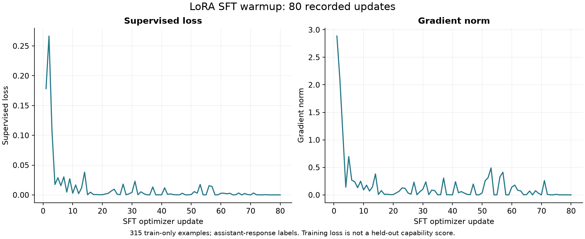
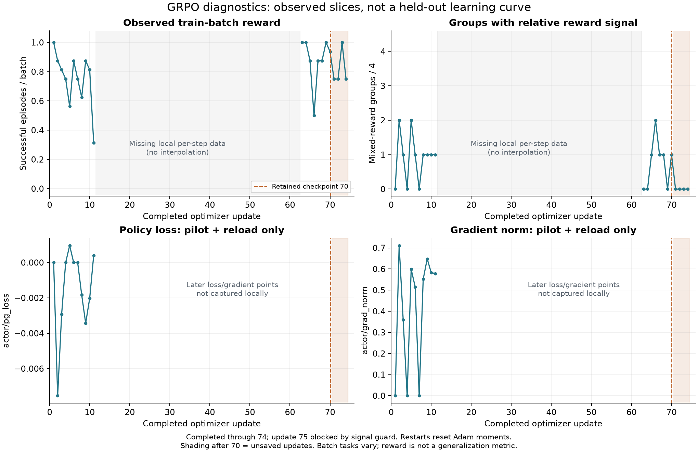

# 第 15 天：结果展示与可复算交付

2026-10-21。交付范围是基于现有证据的图表、案例、离线演示、复现指南和简历材料。没有继续训练、重新运行 test、启动 GPU 作业或发布到外部平台。

## 交付清单

| 交付 | 入口 |
| --- | --- |
| 项目介绍与架构 | [项目卡](PROJECT_CARD.md) |
| 简历三条描述、一分钟介绍、14 个追问 | [简历与面试](RESUME_AND_INTERVIEW.md) |
| 离线复算、三分钟演示与真实推理命令 | [复现指南](DAY15_REPRODUCE.md) |
| 效果原始数字、来源 SHA256 | `artifacts/day15/metrics.json`、`evaluation_summary.csv` |
| 完整 80 次 SFT 更新曲线 | `artifacts/day15/figures/sft_training.png`、同名 PDF |
| 有缺口的 GRPO 诊断切片 | `artifacts/day15/figures/training_diagnostics.png`、同名 PDF |
| 三组独立比较的结果图 | `artifacts/day15/figures/evaluation_comparison.png`、同名 PDF |
| 改善 / 退化 / 共同失败案例 | `artifacts/day15/cases/`，含原始轨迹与实际 patch diff |
| 可执行记录回放 | `python3 scripts/day15_demo.py --case improvement` |
| 可分享离线证据包 | `artifacts/day15/zzh-repair-evidence.tar.gz`，附 SHA256 |
| 本日证据验收 | `python3 scripts/check_day15.py` → `reports/day15_acceptance.json` |

证据包只用于结果复算与回放，不包含完整模型、SSH 私钥、评价 token、私有测试输入、参考实现或完整训练源码。项目未自动上传或创建公开链接。

## 实测结论

| 范围 | SFT-only | step70 | 差值 | 配对改善 / 退化 |
| --- | ---: | ---: | ---: | ---: |
| 冻结 dev，Transformers | 63/96 | 72/96 | +9.375 pp | 11 / 2 |
| 独立 test，Transformers | 90/126 | 93/126 | +2.381 pp | 7 / 4 |
| ZzhClaw 应用 dev，vLLM | 69/96 | 75/96 | +6.25 pp | 9 / 3 |

首要对外效果证据是独立 test，不能只报较大的开发集收益。最终 test 为 42 个原题来源 × 3 seeds，另有 8 个模型无关排除来源；不是 126 道独立原题。dev 为 32 个变体、14 个来源 × 3 seeds。未检验统计显著性。

## 曲线的证据覆盖

SFT 的 80 次更新 loss / gradient 记录完整，来源为 `reports/day7_sft_warmup.json`。

GRPO 实际完成更新 1–74 的索引由已保存只读诊断提供；本机逐 batch 数值只覆盖 **1–11 与 63–74，共 23 步**。12–62 的 51 个点留空，不将训练成功率摘要插值成完整曲线；loss / gradient 图仅使用早期 1–11 步。原 10 月 15 日快照中的 12–14 属于后来丢弃的暂停分支，不接入当前候选曲线。

远端新日志只读同步尝试返回 `Connection closed`，未据此判断权重丢失或实例释放，也没有为了展示擅自开 GPU。完整 GRPO 曲线的补齐留待实例可连接后的日志同步，不影响现有完整评估结果。

第 75 个 batch 的连续零相对奖励保护在写审计及优化器更新前触发；只声称完成 74 次更新，候选为最近完整 checkpoint70。训练 batch 的题目在变化，奖励曲线不能代替 held-out 评估，也不能证明收敛。恢复时 Adam 动量重建，整条过程不是不中断的同一优化器运行。

## 正反案例

1. **改善**：`mbpp-548-m01 / seed29`，LIS。SFT 的 `range(1,n+1)` 会越界，step70 使用合法边界，结果从 0 到 1。
2. **退化**：`mbpp-577-m02 / seed43`，阶乘末位。SFT 正确，step70 写出的分支规则不能通过完整验收，结果从 1 到 0。
3. **共同失败**：`mbpp-526-m01 / seed17`，首尾字母大写。两个模型都未完成尾字母要求，公开测试失败后仍主动结束。

这三题是为了说明机制挑选的 dev 案例，不是随机样本，不替代全量统计。所有回放明确标记“已记录轨迹”，不将重新播放输出当作新推理或新模型成功率。

## 验收边界与下一步

本日验收 **17/17 项通过，complete=true**：检查原始配对结果复算、source SHA256、缺失指标保持空白、三类原始轨迹一致、离线回放、PNG/PDF 完整、文档和证据包清单及哈希。三张图均经过实际图像检查。证据包已在临时解包目录通过标准库环境（`python -S`、清理环境变量）的数字重建、三类演示与完整校验共 5 条命令，退出码全部为 0，记录于 `reports/day15_portability.json`。此验证不依赖外部 ZzhClaw 仓库、GPU 或第三方 Python 包。

材料整理完成不表示以下事项已完成：原 225/255 步训练、完整 GRPO 原始日志曲线、实例外完整权重备份、全新 GPU 环境重新训练、实时演示录屏、公开发布、通用真实仓库或完整 UI / 工具集验收。验收报告分别记录这些状态，不用一个 complete 标记代替所有目标。

当前可直接阅读简历与面试材料并练习三分钟讲解；如准备继续训练，另建实验配置与记录，既有 test 已被查看，后续评估不能继续声称它是全新未见盲测。
