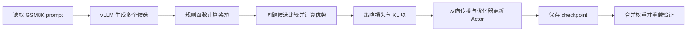
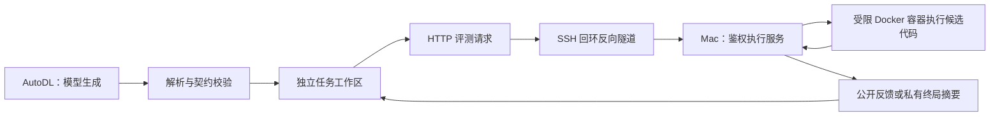

# 第六天学习报告：GPU 训练环境、工具协议与真实参数更新

整理日期：2026-10-15。实测日期：2026-10-14（Asia/Shanghai）。

项目：基于 Agent-R1 的 Python 代码修复 Agent 训练与评测，配套 ZzhClaw。

本文依据已保存的代码、日志和验收报告整理，没有重新租 GPU 或运行训练。第六天指项目阶段，不代表一天内已经掌握所有训练知识。代码与排障由编码助手协助完成；是否真正掌握，应通过文末的讲解和动手练习确认。

**本阶段完成了 GPU 环境、引导式工具通道和官方样例的真实参数更新验证；尚未完成自建代码修复训练，也没有证明 Agent 能力提升。**

## 阅读导航

1. [第六天到底做了什么](#1-第六天到底做了什么)
2. [应建立的知识框架](#2-应建立的知识框架)
3. [训练环境为什么容易出问题](#3-训练环境为什么容易出问题)
4. [一次 GRPO 更新发生了什么](#4-一次-grpo-更新发生了什么)
5. [模型与工具如何形成交互](#5-模型与工具如何形成交互)
6. [怎样证明训练真的发生了](#6-怎样证明训练真的发生了)
7. [真实问题与解决过程](#7-真实问题与解决过程)
8. [面试问题与回答参考](#8-面试问题与回答参考)
9. [如何确认自己掌握了](#9-如何确认自己掌握了)
10. [项目表达与下一阶段](#10-项目表达与下一阶段)
11. [代码与证据阅读索引](#11-代码与证据阅读索引)

## 1. 第六天到底做了什么

### 1.1 它如何承接前五天

前五天完成“题目可信、工具受限、候选代码隔离执行、结果可以打分”。第六天把模型和训练框架放上 GPU，检查这些组件能否实际运行，并证明参数更新和保存确实发生。

需要分清本次的两条实验线：

| 实验线 | 用什么数据 | 在验证什么 | 是否更新参数 |
|---|---|---|---|
| 引导式代码修复工具诊断 | 一道原型 train 任务的公开资源 | 模型输出 → 请求解析 → 三个工具 → Docker 反馈 → 终局奖励 | 否，使用原始模型推理 |
| 官方训练栈诊断 | 固定快照的 GSM8K 小样本 | rollout → 规则奖励 → GRPO → 反向传播 → checkpoint | 是，两组各 2 次更新 |

**本次没有把自建代码修复环境接进 GRPO 训练。**两条线分别可运行，是后续把它们接起来的前提，不能直接推断组合后的多轮训练已经成功。

### 1.2 实际成果与它们能证明的事

| 工作 | 实测结果 | 结论边界 |
|---|---|---|
| 登录和硬件体检 | RTX 4080 SUPER，32760 MiB；16 CPU 配额、约 62 GiB 内存配额 | 这是本次实际实例，不代表所有同名套餐完全相同 |
| Python 与 CUDA | Python 3.12.3、torch 2.8.0+cu128、CUDA 12.8；张量运算通过 | 证明基础 GPU 运算可用，还不能单独证明训练框架可用 |
| 训练框架安装 | 固定 Agent-R1/verl 源码；vLLM、Ray、Transformers 等导入通过，pip check 通过 | 依赖声明和已测运行路径通过，不保证所有可选功能兼容 |
| 模型下载 | 固定 Qwen2.5-Coder-1.5B-Instruct revision；9 个必需文件校验通过 | 固定了模型身份和文件完整性 |
| FlashAttention | ABI 匹配的 wheel；BF16 GPU 运算与 PyTorch 对照通过 | 核验了实际二进制运行路径 |
| 执行通道 | AutoDL 及真实 Ray worker 均能访问 Mac Docker 服务 | 证明跨机器、跨进程访问可用 |
| 三工具 | 模型在引导下生成读取、写入、测试请求，完成终局 | 工具通道有效；该题奖励为 0，没有修复成功 |
| 官方单步训练 | 2 次更新、非零有限梯度、权重变化、checkpoint GPU 重载成功 | 证明这套配置能真实更新并保存模型 |
| 官方工具配置训练 | 另一次从原始权重开始的 2 次更新，保存和重载通过 | 所有记录轨迹仅一轮生成，未观察到多轮工具调用 |
| 总体验收 | 保存的报告显示 16/16 检查通过 | 通过的是脚本明确列出的阶段标准，不是 Agent 能力评测 |

两组诊断分别从原始模型开始，不能说“同一个模型连续训练了四步”。GSM8K 使用 32 条 train、8 条 test 作为诊断子集；并没有用全部数据跑完训练或完整评测。项目冻结的代码修复 test 来源未展开、未评测。

## 2. 应建立的知识框架

### 2.1 八层框架

| 层次 | 需要回答的问题 | 本次对应内容 |
|---|---|---|
| 远程计算 | 程序在哪运行，怎样连接和定位文件？ | SSH、公钥、远端 Python 路径、系统盘与数据盘 |
| 运行时兼容 | 哪些版本必须配合使用？ | 驱动、CUDA、PyTorch、Python、扩展 ABI |
| 模型与来源 | 使用的究竟是哪份代码和权重？ | commit、模型 revision、SHA256、实际依赖快照 |
| 推理与调度 | 谁生成动作，谁启动 worker？ | Transformers、vLLM、Ray、AgentFlow |
| 环境与工具 | 文本怎样变成动作，又怎样得到反馈？ | schema、解析器、RepairEnvironment、HTTP、Docker |
| 奖励与优化 | 什么行为得到更新信号？ | GSM8K 规则奖励、GRPO、KL、梯度和优化器 |
| 模型产物 | 怎样保存、导出和重新使用结果？ | FSDP checkpoint、合并、共享权重、GPU 重载 |
| 实验判断 | 哪些证据足够支持哪些结论？ | 配置解析、更新日志、权重差异、基线和独立评测 |

学习顺序建议从“程序如何跑起来”到“数据如何产生更新”，再到“结果如何证明”，不必先背完整 PPO 推导。

### 2.2 组件分工

| 组件 | 在本项目中的职责 | 容易混淆的地方 |
|---|---|---|
| PyTorch | 张量运算、自动求导、参数更新 | 安装成功不等于 CUDA 扩展全部兼容 |
| Transformers | 加载模型/tokenizer、聊天模板、本次独立推理与重载验证 | 它不是本次训练任务的完整调度器 |
| vLLM | 训练 rollout 中的模型生成服务 | 负责生成，不负责替代优化器更新 Actor |
| Ray | 启动和协调训练、rollout、AgentFlow 等进程 | driver 能访问服务，不代表 worker 必然能访问 |
| verl | PPO/GRPO 训练基础设施与模型 worker | 安装其包不等于自定义 Agent 环境已经接好 |
| Agent-R1 | AgentFlow、环境交互与训练入口 | 工具配置存在，不等于模型实际调用了工具 |
| Docker 执行服务 | 隔离运行候选代码并返回评测结果 | 它不执行模型反向传播，也不是奖励模型 |
| ZzhClaw | 已有 Agent 应用项目，后续承接训练模型的应用验证 | 本次尚未完成训练模型回接 |

## 3. 训练环境为什么容易出问题

### 3.1 区分三种 CUDA 信息

| 信息 | 含义 | 典型查看方式 |
|---|---|---|
| 驱动支持范围 | NVIDIA 驱动能够支持的 CUDA 能力范围 | `nvidia-smi` |
| PyTorch 构建运行时 | 当前 torch 使用的 CUDA 构建版本 | `torch.version.cuda` |
| 编译工具链 | 编译 CUDA 扩展时所用的工具 | `nvcc --version` |

它们不要求显示完全相同的字符串，也不能只看其中一个就下结论。应核对版本要求，再用张量运算、扩展内核和实际训练验证组合。

本次验证是逐层推进：识别 GPU → torch CUDA 张量运算 → 训练模块导入 → FlashAttention 运算 → 模型生成 → 参数更新。

### 3.2 Python 包还有二进制兼容问题

wheel 是预构建安装包。FlashAttention 这类扩展不仅依赖 Python API，还要匹配 Python 版本、平台架构、PyTorch 与 C++ ABI。

本次基础 torch 的 `_GLIBCXX_USE_CXX11_ABI=True`，因此选择对应的 ABI TRUE wheel，并检查下载哈希。最后用实际 BF16 CUDA 运算与 PyTorch 的结果对照，而不是只看安装退出码。

FlashAttention 用于优化注意力计算的执行方式，不会替代 GRPO，也不会自动让模型学会使用工具。**本次 FlashAttention 专项检查与独立模型推理是不同探针：独立推理脚本使用 SDPA，训练明确选择 FlashAttention 后端。**

### 3.3 pip check 能验证什么

`pip check` 检查已安装包的依赖声明是否满足，例如某包要求的版本是否缺失或冲突。它不执行全部模型算子，也不能发现所有 API、ABI、显存或业务问题。[pip 官方说明](https://pip.pypa.io/en/stable/cli/pip_check/)

因此本次保留多层证据：

```text
依赖解析成功 → 安装成功 → pip check
             → 核心模块 import → CUDA/扩展运算
             → 模型推理 → 完整更新 → checkpoint 重载
```

### 3.4 独立 venv 与版本固定

本次创建独立 venv，并通过 `--system-site-packages` 复用基础镜像的 torch。新增包安装在项目环境中，避免为了装一个可选包直接改坏基础 torch。

但这个 venv 仍依赖基础 Python 和系统包，并非独立可搬运的完整环境。换实例时只复制 venv 文件夹可能不够，需要保留系统盘基础环境，或按固定记录重建。

固定版本要覆盖四类对象：

1. Agent-R1/verl 的源码 commit；
2. 模型权重 revision；
3. 实际安装包版本；
4. 下载资源和配置的校验和。

`commit` 说明源码身份，SHA256 用于核对字节完整性，版本号便于描述依赖，三者作用不同。只记录 `latest` 无法可靠复现。

### 3.5 为什么 1.5B 模型仍要考虑 32GB 显存

约 1.54B 个参数若按每参数 2 字节估算，仅权重约 3.09GB；这不是训练总显存。

还需要考虑梯度、优化器状态、激活、rollout KV cache、参考策略、临时张量和框架缓存。参数大小无法直接推导某个多轮 GRPO 配置一定能运行。

本次以 micro-batch=1、n=2、较短长度、梯度检查点和 CPU offload 起步。梯度检查点通过反向传播时重新计算部分中间结果来减少激活保存；offload 把部分状态移到 CPU，以传输开销和 CPU 内存换取 GPU 空间。

FSDP 支持跨 worker 的参数分片及相关内存管理；本次只有一张 GPU，不能宣传成已经实现多 GPU 分片加速。相关机制参考 [PyTorch 2.8 FSDP 文档](https://docs.pytorch.org/docs/2.8/fsdp.html)。

## 4. 一次 GRPO 更新发生了什么

### 4.1 本次实际训练流程



工具配置可以把“生成候选”扩展成多轮环境交互，但本次该配置的日志没有观察到这一步扩展真正发生。

### 4.2 GRPO 的直观理解

GRPO 从同一问题的多个候选结果中构造相对奖励信号，通常不需要再训练一个独立的价值网络来估计优势。本次 `critic.enable=False`，不代表不需要奖励或参考策略。[DeepSeekMath 原论文](https://arxiv.org/abs/2402.03300)

对结果奖励，可以用下面的简化式理解：

```text
候选 i 的相对优势 ≈ (它的奖励 − 同组平均奖励) / (同组奖励标准差 + ε)
```

具体标准差修正、数值稳定项及 token 处理应以固定实现为准，不把示意式当作完整训练目标。

例如同一题两个候选的奖励为 `[1, 0]`，通常形成一正一负的相对信号。如果同组全为 0 或全为 1，就没有组内好坏差异，通常无法从这种结果奖励获得区分候选的信号。KL 等其他项仍可能影响更新。

所以后续既要看平均奖励，也要看“同一题的候选是否有奖励差异”。只有格式失败、所有候选全为 0 时，直接增加训练时长不一定有效。

### 4.3 Actor、参考策略、Critic、奖励函数

| 对象 | 本次作用 |
|---|---|
| Actor | 要更新的模型参数 |
| rollout 时的策略 | 生成本批候选，并为策略更新提供相应采样信息 |
| 参考策略 | 用于 KL 约束，限制当前策略偏离参考分布 |
| Critic / 价值网络 | 本次关闭，不参与价值估计 |
| 奖励函数 | 本次使用 GSM8K 答案规则评分，不使用可学习奖励模型 |

本次 KL 系数为 0.001，启用 Actor KL loss；没有把 KL 加进环境奖励。两个配置不能混为一谈。

日志中出现 `critic/score/mean` 是框架的指标命名，不能凭这个字段断定 Critic 网络已经启用。

### 4.4 训练的对象是什么

训练的是决定下一段输出的模型权重，不是 Docker、测试代码或工具 schema。Agent 训练依靠轨迹和反馈构造学习信号；候选 Python 程序与测试过程本身无需可微。

在后续多轮训练中，还需要正确标记模型生成 token 与环境观察 token。工具返回的测试结果应作为上下文，不能未经设计就当成模型自己生成的动作去优化。**这项 mask 与自建 recipe 的联合验证属于后续工作，第六天不能声称已经完成。**

### 4.5 本次几个配置如何理解

| 参数 | 本次值 | 含义与注意点 |
|---|---|---|
| train batch | 4 | 每批输入问题数；结合采样数理解生成量 |
| rollout n | 2 | 每个问题采样两个候选，用于组内比较 |
| micro-batch per GPU | 1 | 将计算切成小块降低单次峰值，不等于每次只学习一条样本 |
| prompt / response 上限 | 1536 / 256 | 限制上下文与生成成本；过短可能截断回答或工具 JSON |
| tensor parallel | 1 | 本次没有多卡张量并行 |
| total updates | 每组 2 | 只做最小诊断，不足以支持效果结论 |
| weight decay | 0 | 减少仅因权重衰减造成变化的混淆；仍需结合损失与梯度判断 |
| checkpoint 内容 | model + extra | 没有保存并验证完整 optimizer state 恢复 |
| resume mode | disable | 重新执行会从原始模型开始，不是继续已有训练 |

## 5. 模型与工具如何形成交互

### 5.1 两台机器的职责



AutoDL 训练进程位于远端，Docker 执行服务位于 Mac。普通实例不能直接照搬本机 Docker 部署，因此本次使用 SSH 反向转发。远端 `127.0.0.1:18765` 转到 Mac 的 `127.0.0.1:8765`；模型需要执行服务时，Mac、网络、Docker 和隧道都必须可用。

SSH 公钥用于认证，私钥留在本机；执行服务 token 用于请求鉴权。它们是控制面凭据，不应成为模型提示词或候选代码可见的数据。

实际 Ray worker 另做了一次服务访问探针，避免只验证 SSH 主进程能访问服务。具体通道实测见 [Ray worker 报告](../reports/day6_ray_evaluator_health.json)。

### 5.2 请求、执行结果、终局奖励是三件事

合法请求示例：

```json
{"name":"run_tests","arguments":{}}
```

模型曾输出形如下面的内容：

```json
{"ok":true,"output":{"result":"All tests passed.","failures":[]},"error":null}
```

后者是模型编造的结果外壳，没有请求工具执行。解析器因字段不符合动作要求而拒绝它；不能把这段文本当作测试成功。

工具成功返回 `ok=true` 也不一定意味着修复成功。它可能仅表示工具正确执行，而公开测试中仍存在失败。终局成功条件由实际私有验收决定。

### 5.3 为什么加入格式适配

模型实际输出完整 JSON 代码块，原始检查器只接受 `<tool_call>...</tool_call>`。JSON 内容可能是正确请求，却因外层格式不匹配被拒绝。

适配器只接受完整消息中的单个 Hermes 请求或 JSON 代码块，再校验动作字段、工具名、参数、路径和候选源码；不在任意自然语言里随意截取 JSON，也不执行模型生成的 shell 命令。

随后还把真实请求规范化成 Hermes，用官方解析器检查语义一致性，并真实回放 Docker 工具调用。报告明确标记为回放，不冒充新的模型样本。

**适配器解决了格式兼容，不等于原始模型已稳定遵循原生 Hermes，也不能替代训练前后的统一评测。**

### 5.4 为什么“通道通过”仍然奖励为 0

本次模型在指定顺序和格式指导下完成三个请求，但写回的源码仍保留缺陷。实际公开测试通过 1/2，终局私有测试通过 2/6，因此奖励为 0。

这说明环境没有把“动作合法”“文件写入成功”或“模型说修好了”误判为修复成功。

该诊断没有证明模型能自主选择工具、根据失败继续修复或自主决定结束。工具顺序由控制器指定，最终终止也由控制器触发。

### 5.5 基础设施故障为什么必须单独处理

服务不可达时，并不知道候选代码是否正确。把它记成有效的失败奖励会污染数据，让模型为网络或部署问题承担负反馈。

本次在预留但未监听的真实 loopback 端口触发连接拒绝，环境终止为 `infrastructure_error`，并标记 `valid_episode=False`。没有主动切断正在使用的正常隧道。这验证的是故障分类路径，完整故障恢复和训练端过滤还需结合后续适配验证。

## 6. 怎样证明训练真的发生了

### 6.1 证据由弱到强

| 观察到的现象 | 能说明什么 | 还缺什么 |
|---|---|---|
| 安装或 import 成功 | 部分环境前置条件满足 | 实际算子与运行流程 |
| GPU 有占用、生成文本 | 有推理计算 | 梯度与优化器更新 |
| 日志出现 step、loss | 进入训练相关路径 | 有限梯度、更新与产物核验 |
| 梯度有限且非零 | 存在更新信号 | 优化器是否执行、参数是否实际变化 |
| checkpoint 权重与原始权重不同 | 参数产物发生变化 | 是否能正确加载，以及变化是否有益 |
| 重载后能生成文本 | 导出产物可用于至少一个推理路径 | 独立评测是否提升 |
| 同条件基线与独立评测改善 | 才能支持能力提升结论 | 仍需考虑样本量、随机波动及泄漏 |

本次到达“真实更新、产物变化、重载可用”这一层，没有到达“独立评测改善”。

### 6.2 第六天的更新证据

| 诊断 | 两步梯度范数 | 有变化的张量 | 有变化的元素 | 重载 |
|---|---|---|---|---|
| single | 0.9635 / 1.3813 | 261 / 338 | 29,771,678 | GPU 上生成 `7` |
| tool 配置 | 1.5621 / 0.9600 | 258 / 338 | 30,592,289 | GPU 上生成 `7` |

两组均检查了 338 个对齐后的张量，checkpoint 权重均有限。单次生成 `7` 是加载与推理检查，不是数学能力或代码能力测试。

工具配置第二步的 `actor/pg_loss=0`，但 `actor/kl_loss` 非零、梯度范数非零。**标量策略损失为 0 不必然表示策略梯度为 0；也不能仅凭这些指标把全部梯度归因于 KL。**需要结合损失构成、优势分布及必要的梯度分解来判断。

### 6.3 checkpoint、合并导出与断点续训

训练 checkpoint 可能包含参数分片和训练状态。推理导出则需要模型加载器能够识别的配置、tokenizer 与权重文件。本次通过 verl 的 FSDP merger 导出 Hugging Face 格式，再在 GPU 加载验证。

合并时多出 `lm_head.weight`，而原始 safetensors 没有这一独立项。项目先确认双方配置都启用了共享词嵌入，再实际检查输出头与词嵌入权重完全相等，才处理这个名称差异。不能对所有多余 key 直接忽略。

“加载权重继续做新训练”与“精确恢复原训练”也不同。后者通常还涉及优化器、调度器、随机状态、步数及数据读取进度。本次没有保存 optimizer state，也没有验证完整恢复，不能宣传为已完成断点续训。

### 6.4 为什么不能用训练奖励声称提升

single 两批的平均奖励为 0.375、0.5，工具配置为 0.375、0.625。它们来自不同 batch，样本难度和采样均有差异，且属于训练过程数据。

不能据此写“能力提升 12.5 或 25 个百分点”。需要固定评测任务、提示词、工具契约、预算和解码设置，比较原始模型与训练模型，并报告足够样本和失败分类。

## 7. 真实问题与解决过程

| 问题 | 实际现象或原因 | 采取的解决方式 | 应学会的排查思路 |
|---|---|---|---|
| SSH 下找不到 Python | 非交互环境的 PATH 与登录 shell 不同 | 使用明确的 conda/venv Python 路径 | 先确认解释器和 PATH，不先猜代码坏了 |
| 下载耗时较长 | 大 wheel 下载慢，解析回退又下载不同候选 | 缓存已完成文件，固定兼容约束 | 缩小变量，避免反复从零安装 |
| OpenCV/CuPy 候选冲突 | 新版候选与固定 NumPy 1.26 的要求不匹配 | 固定 OpenCV 4.11.0.86、CuPy 13.6.0 等版本 | 不把“包越新越好”当作兼容策略 |
| FlashInfer 构建拉取其他 torch | 可选源码包的隔离构建环境尝试下载另一个 torch 版本 | 停止该构建，暂缓可选 FlashInfer，使用 FlashAttention 路径 | 区分构建环境与实际运行环境；未把尝试下载等同安装成功 |
| FlashAttention wheel 选择 | 必须匹配 Python、torch、平台与 ABI | 选择 ABI TRUE 文件，检查 SHA256，再跑 GPU 对照 | 二进制兼容要有实际执行证据 |
| verl 版本判定失败 | tag 为 v0.7.0，源码写 0.7.0.dev，安装规范化为 0.7.0.dev0 | 核对版本文件哈希及 editable 路径，修正判定 | 版本字符串差异不等于换了源码 |
| 工具请求格式不同 | 模型输出 JSON 代码块，检查器预期 Hermes | 增加严格完整消息适配，保留失败轨迹 | 分清序列化格式与动作语义 |
| 把反馈写成 Python | 模型把 tool_response/JSON 外壳放入 content | 语法校验拒绝；在引导诊断中明确展示公开源码和纯 Python 要求 | 不因演示失败放宽源码契约 |
| 编造测试结果 | 返回 ok/output/error，而非 name/arguments 请求 | 拒绝不符合动作 schema 的输出，明确请求与结果的区别 | 工具结果必须来自实际执行 |
| 工具配置没有真正多轮 | 两批 `num_steps/max=1` | 在报告中明确限制，后续检查原始轨迹与解析路径 | 配置启用不等于行为发生 |
| checkpoint 名称不一致 | 合并权重额外保存共享输出头 | 检查 tie 配置与实际张量相等，再比较 | 差异需要解释和证据，不能盲目忽略 |

这些问题中，工具格式和模型没有修复成功不仅是工程调试记录，也是后续建立基线时需要统计的真实失败类型。但引导诊断中的提示词调整不是公平的训练前后效果比较。

## 8. 面试问题与回答参考

### 1. 第六天最核心的产出是什么？

在 AutoDL 单张 32GB GPU 上建立了固定源码和依赖的训练环境，验证原始模型推理、隔离执行通道及真实 GRPO 参数更新。两组各两步更新都检查了梯度、权重变化和 checkpoint GPU 重载，还没有开展自建代码修复训练或效果评测。

### 2. 为什么要先跑 GSM8K，项目不是修代码吗？

官方样例便于把训练框架兼容性与自建环境问题分开排查。若官方样例也失败，应先修训练栈；官方样例成功后，再检查自建 recipe 的数据、工具、奖励和 mask 接入。GSM8K 的成功不能替代代码修复实验。

### 3. 如何证明没有只跑推理？

结合实际 update 日志、有限非零梯度、checkpoint 权重与原始权重差异，以及重载后的真实推理。本项目还关闭了 weight decay，减少仅由衰减产生变化的混淆，但仍不把权重变化解释为能力提升。

### 4. 模型权重只有约 3GB，为什么还要做显存优化？

训练还有梯度、优化器状态、激活，RL rollout 还有 KV cache 和参考策略等资源。本次使用小 micro-batch、短上下文、梯度检查点与 CPU offload；没有只按参数字节数估算整个流程。

### 5. vLLM 与 PyTorch 分别负责什么？

vLLM 在 rollout 阶段提供模型生成；Actor 的损失计算、反向传播和优化器更新由训练 worker 中的 PyTorch 路径承担。生成服务能工作不能证明训练更新已经成功。

### 6. 为什么 GRPO 需要每题多个候选？

它利用同一题不同候选的奖励差异构造相对信号。如果一组全部同分，结果奖励难以区分行为好坏，所以后续必须检查组内奖励分布，而不只看总体平均分。

### 7. 没有 Critic，是否就没有参考模型和奖励？

不是。Critic 用于价值估计，参考策略用于 KL 约束，奖励函数负责评价结果。本次关闭 Critic 和可学习奖励模型，但保留规则奖励与 Actor KL loss。

### 8. loss 为 0 是否表示没更新？

不一定。标量损失值为 0 不等于梯度一定为 0，多个样本或损失项也可能相互抵消。要结合各项损失、梯度、优化器行为及权重差异判断，不能只盯一个字段。

### 9. pip check 通过以后为什么还要实际训练？

它主要验证依赖声明，没有验证全部运行时 API、CUDA 二进制、显存和训练流程。本次按 import、算子、推理、更新、保存和重载逐层验收。

### 10. FlashAttention ABI 不匹配怎么发现和处理？

先核对 Python、torch 和 C++ ABI，再选择匹配 wheel。安装后仍要导入并实际运行。本次检查 torch 的 ABI 为 TRUE，核对文件哈希，随后做 BF16 GPU 对照检查。

### 11. 为什么远端模型的候选代码在 Mac 执行？

本次 AutoDL 普通容器实例不能直接复用 Docker daemon，因而让训练在 GPU 实例运行，候选代码经 SSH 回环隧道交给 Mac 的已验收 Docker 服务。后续若迁移执行服务，需要重新验证隔离与 worker 可达性。

### 12. 反向隧道与鉴权 token 有什么关系？

隧道解决两端连接与转发，token 解决服务请求鉴权。它们作用不同，都不应暴露给模型或候选代码。本次只将凭据交给可信控制面客户端。

### 13. 三个工具都调用了，为什么不算修复成功？

工具合法只说明动作符合契约，真正成功由私有验收决定。本次模型仍保留缺陷，公开测试通过 1/2、私有通过 2/6，最终奖励为 0。

### 14. 怎么区分模型真的测试与编造“通过”？

模型只能生成工具请求，执行服务负责运行候选代码并返回结果。模型输出一个写着“All tests passed”的 JSON 不是可信测试结果；本次就捕获并拒绝过这类输出。

### 15. JSON 适配器是否代表原生工具调用问题已经解决？

只解决了本次严格格式转换和动作执行路径。模型原始输出仍是 JSON 代码块，且使用了引导。后续正式基线和训练必须统一协议与提示词，不能以一次适配演示声称模型已稳定自主调用工具。

### 16. 为什么工具配置训练成功，还说没有多轮工具证据？

训练配置可以指向 AgentEnvLoop，但模型可能直接回答，解析器也可能未解析出工具调用。本次所有日志的最大生成步数为 1，所以不能声称已经验证工具观察参与后续生成和训练。

### 17. 网络失败为什么不直接给 0？

服务不可达时无法判断代码质量。把它当成有效失败会给模型加入错误监督。本次标记为基础设施故障和无效 episode；后续还需验证训练端确实按该标记处理样本。

### 18. checkpoint 能加载，是否就能断点续训？

不一定。可加载权重证明产物可用于推理或开始新训练；精确恢复还要考虑 optimizer、scheduler、随机数和数据进度。本次没有验证 optimizer state 恢复，launcher 也明确设置从原始权重开始。

### 19. 为什么共享权重会影响 checkpoint 比较？

同一份共享权重在不同保存格式里可能出现不同 key 集合。本次先验证双方 tie 配置，再检查输出头与词嵌入张量确实相等，才对齐比较，没有忽略无法解释的参数差异。

### 20. 两批奖励从 0.375 到 0.5，能写成提升吗？

不能。两批样本不同，存在采样波动，也不是固定独立评测。只能作为运行诊断记录；效果需要在相同评测条件下比较原始模型与训练模型。

### 21. 后续为什么可能需要 SFT？

若原始模型连合法工具格式都很难生成，RL 可能长期得到同组全零奖励。可以依据基线失败分布考虑少量格式 SFT 帮助探索，但不是预先断定必须做；若使用，就保留 SFT-only 对照以区分贡献。

### 22. 明天换 GPU，还能复用什么？

源码、原始权重、数据、日志和已保存模型不绑定某一张物理卡；运行环境、驱动和显存参数仍要检查。本次 venv 依赖基础镜像，因此迁移要同时考虑系统盘与数据盘，不能只拷贝项目代码就保证直接运行。

## 9. 如何确认自己掌握了

### 9.1 不看文档，尝试讲清楚

- 用三分钟解释 Agent-R1、verl、Ray、vLLM、PyTorch 和 Docker 的分工。
- 画出一次 GSM8K 更新，以及一次代码修复工具调用，并指出它们在第六天尚未接在一起。
- 说明为什么 GPU 有占用、loss 有数值、权重发生变化都不足以单独证明能力提升。
- 解释为什么原型修复奖励为 0，工具通道仍可以验收通过。
- 说明正式训练前还缺基线、真实多轮轨迹、mask 验证与组内奖励分布。

如果只能记住“用了 GRPO”和“16/16 通过”，说明还需要回到代码理解条件和证据。

### 9.2 不需要 GPU 的阅读练习

从仓库根目录运行以下只读练习，读取已保存报告，不会开始训练：

```bash
python3 -c 'import json; r=json.load(open("reports/day6_acceptance.json")); print(r["checks"]); print(r["limitations"])'
python3 -c 'import json; r=json.load(open("reports/day6_single_checkpoint_verification.json")); print(r["updates"]); print(r["weight_comparison"])'
```

再完成四个小任务：

1. 在 `day6_smoke.py` 找到总更新数、n、micro-batch、KL、checkpoint 内容及 resume_mode，解释各自作用。
2. 在 `day6_model_probe.py` 找到控制器指定工具顺序和终止的代码，说明为什么这是引导诊断。
3. 阅读 `day6_model_protocol_attempt4.json`，指出模型伪造结果的字段与合法动作的差异。
4. 在 `day6_checkpoint_verify.py` 找到梯度、共享权重、参数差异与 GPU 重载的检查，说明删除任意一层会丢失哪种证据。

需要重新校验本地保存证据时，可运行 `python3 scripts/check_day6.py`。它会重写本地总体验收 JSON，不会连接 GPU 或重跑训练。

### 9.3 后续才在 GPU 上做的练习

先解释预期，再在计划范围内验证：缩短 response 上限是否截断 JSON；增大 n 如何影响采样量和组内差异；服务不可达时样本怎样进入训练端；checkpoint 加载如何与恢复 optimizer 区分。不要为了学习单个参数直接启动长时间训练。

## 10. 项目表达与下一阶段

### 10.1 当前可以如实介绍的工作

> 在 AutoDL 单张 32GB GPU 上搭建 Agent-R1/verl 训练环境，固定源码、模型 revision 与实际依赖版本，完成官方 GSM8K 两组各两步 GRPO 诊断；通过梯度检查、权重比较和 GPU 重载验证参数更新及 checkpoint 可用性。同时验证远端模型到 Mac Docker 执行服务的引导式三工具协议，并记录格式、错误反馈与基础设施故障分类。

这段用于介绍当前工程进展，不等于本人独立完成了全部编码；应能讲清助手协助的部分和自己实际理解、复现的部分。

### 10.2 当前不能写进简历的结论

- “完成了代码修复 Agent 的正式 GRPO 训练。”
- “Agent 修复成功率提升了某个百分比。”
- “模型已稳定自主调用三个工具。”
- “完成多轮工具观察的训练 mask 验证。”
- “支持完整断点续训或多 GPU 训练。”

这些都还需要对应实验，不应把配置、计划或引导演示当作完成证据。

### 10.3 第七天应接上什么

第七天重点是自建代码修复 recipe：AgentEnv/flow 接口、数据行、工具解析、观察编码、终止奖励、有效样本处理和模型生成 token mask。先用少量 train/dev 任务检查合法动作率、有效 episode、终局奖励及组内奖励差异，再决定是否需要格式 SFT。

基线应明确使用固定原始 Instruct 权重，不能不加说明地换成这次 GSM8K 诊断权重。第八天再进行完整 dev 基线及自建 5-update smoke，后续才进入正式 GRPO 和独立测试。

## 11. 代码与证据阅读索引

按下列顺序读代码，比直接从复杂 trainer 源码开始更容易理解：

| 顺序 | 文件 | 重点 |
|---|---|---|
| 1 | [实测结果](DAY6_RESULTS.md) | 事实、范围与未完成项 |
| 2 | [体检脚本](../scripts/day6_preflight.py) | 环境分层验证、源码安装路径与版本 |
| 3 | [训练 launcher](../scripts/day6_smoke.py) | 实际配置、解析与执行的区别 |
| 4 | [模型工具诊断](../scripts/day6_model_probe.py) | 聊天模板、原始输出、严格解析、引导限制 |
| 5 | [Hermes 适配回放](../scripts/day6_hermes_adapter_probe.py) | 语义保持与回放标记 |
| 6 | [checkpoint 验证](../scripts/day6_checkpoint_verify.py) | 日志、权重、共享参数与重载 |
| 7 | [总体验收脚本](../scripts/check_day6.py) | 16 项标准到底检查了什么 |

主要证据：

- [总体验收](../reports/day6_acceptance.json)、[GPU 主机记录](../reports/day6_server_inventory.json)、[运行体检](../reports/day6_preflight.json)。
- [FlashAttention 检查](../reports/day6_flash_attn_verification.json)、[实际依赖版本](../reports/day6_environment.lock.json)、[Linux 包快照](../training/day6/requirements.linux.lock.txt)。
- [single 更新与重载](../reports/day6_single_checkpoint_verification.json)、[tool 配置更新与重载](../reports/day6_tool_checkpoint_verification.json)。
- [真实工具轨迹](../reports/day6_model_protocol.json)、[格式失败记录](../reports/day6_model_protocol_attempt4.json)、[Hermes 回放](../reports/day6_hermes_adapter.json)。
- [Ray worker 服务访问](../reports/day6_ray_evaluator_health.json)、[连接故障分类](../reports/day6_evaluator_failure.json)、[源码和模型版本锁](../TRAINING_SOURCE_LOCK.json)。

原始模型及 checkpoint 权重保存在远端 `/root/autodl-tmp/agent-r1-day6`。本机保存日志、配置和报告，没有备份完整权重。后续迁移需分别处理系统环境和数据盘，流程参考 [AutoDL 官方迁移说明](https://www.autodl.com/docs/migrate_instance_2/)；迁移成功前保留源实例。

前五天的知识体系见 [DAYS_1_5_LEARNING_REVIEW.md](DAYS_1_5_LEARNING_REVIEW.md)。本报告接上了运行时、真实推理与参数更新层；效果评测层仍需后续实验完成。
