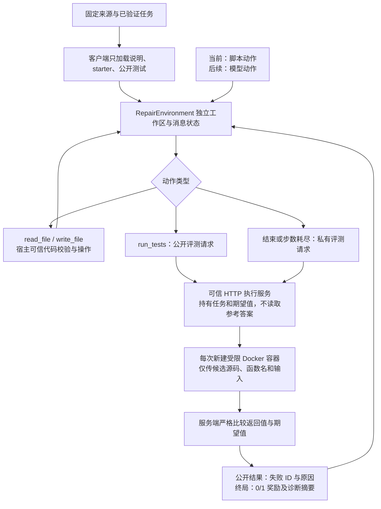

# 前五天项目复盘：工作成果、知识体系、问题解决与面试准备

整理日期：2026-10-13。项目：基于 Agent-R1 的 Python 代码修复 Agent 训练与评测，配套 ZzhClaw。

本文依据当前仓库代码、前五天验收报告及本次开发中的排障记录整理。“前五天”指执行方案的第 1–5 天阶段，不表示已经连续开发了五个自然日。本文未重新运行容器或测试，数字来自已保存的实测报告。

**当前完成的是：可验证的数据流程，以及能够接收 Agent 动作、执行代码、返回反馈和终局奖励的环境。模型尚未接入，也没有进行强化学习参数更新。**

代码由编码助手协助实现；交付完成不等于本人已经独立掌握。下面的“学到什么”应通过讲解、读代码和动手自测确认，面试时应如实说明分工。

## 阅读导航

1. [前五天到底做了什么](#1-前五天到底做了什么)
2. [知识体系与模块关系](#2-知识体系与模块关系)
3. [必须理解的核心知识点](#3-必须理解的核心知识点)
4. [走通一个真实任务](#4-走通一个真实任务)
5. [真实问题与解决过程](#5-真实问题与解决过程)
6. [提前防范的设计风险](#6-提前防范的设计风险)
7. [面试问题与回答参考](#7-面试问题与回答参考)
8. [如何确认自己真的掌握](#8-如何确认自己真的掌握)
9. [项目介绍与简历表达](#9-项目介绍与简历表达)
10. [代码阅读、复现与证据索引](#10-代码阅读复现与证据索引)

## 1. 前五天到底做了什么

### 1.1 项目的问题是什么

研究目标是：在相同工具、提示词和预算下，后续 GRPO 训练能否提高小模型利用公开测试反馈修复 Python 函数的成功率？这个问题还没有得到实验答案。

为了能研究它，先解决四件事：任务本身是否可靠、Agent 可以做什么、生成代码在哪里执行、如何判断修复成功。

| 项目 | 当前分工与边界 |
|---|---|
| ZzhClaw | 已有 Agent 应用项目；本项目后续计划通过受限 profile 接回，尚未完成该接入 |
| 本仓库 | 自建修复任务、三个受限工具、episode 状态、公开反馈、私有验收、容器执行服务、验证报告 |
| Agent-R1 | 后续训练框架；已固定上游 commit，尚未克隆安装或完成接口适配 |
| Qwen2.5-Coder-1.5B-Instruct | 首轮实验选定模型；权重未下载、权重 revision 尚未固定 |
| GRPO | 后续拟使用算法；当前没有 rollout 采样、梯度更新或 checkpoint |

### 1.2 按阶段梳理工作与验收

| 阶段 | 做了什么 | 已有证据 | 学习重点 |
|---|---|---|---|
| 第 1 天 | 固定单文件函数修复范围、四类缺陷、模型与算法选择、三工具契约；生成 20 个原型任务 | 7/7 阶段标准通过；20 题均参考通过、缺陷失败 | 把模糊目标转成任务规格与可执行验收 |
| 第 2–3 天 | 固定 MBPP 官方快照，继承来源划分，AST 缺陷注入、测试扩充、去重、来源冻结及离线重建 | 104/104 任务通过；72 train / 32 dev；50 道 test 来源冻结 | 训练数据工程、泄漏防范、数据质量与版本管理 |
| 第 4–5 天 | 完成独立工作区、工具调度、终局奖励、独立 HTTP 执行服务；安装 Docker 并实测隔离 | 22/22 隔离检查；252 次脚本 episode；60/60 自动测试；总验收 14/14 | Agent 环境工程、权限边界、异常处理、并发隔离与证据链 |

有些工具与环境原型提前完成，阶段表按最终交付归类，不代表每个文件严格在对应“天”才创建。

### 1.3 数字应该怎样理解

- **20 个原型任务**：本仓库编写，10 train、10 dev，来自 20 个不同原题；用于调试协议和环境。
- **104 个正式来源任务**：从 45 道 MBPP 原题转化而来，31 道 train 原题产生 72 个任务，14 道 dev 原题产生 32 个任务。
- **每个正式任务 2 条公开、7 条私有用例**：同一道原题的多个缺陷变体会共享用例，不能把所有用例计数当成独立输入数量。
- **50 道 test 来源**：只冻结原题名单和指纹；没有构建最终 test 任务，也没有运行其参考实现或模型评测。
- **124 个任务、252 次 episode**：`(20 + 104) × 2 + 4 = 252`。每题各跑一次原始缺陷和已知正确补丁，再加 4 次并发检查。
- **60 个自动测试**：覆盖契约、数据、环境、执行器、服务等；不等于 60 个模型修复样本。
- **22 项隔离检查**：包含权限与资源探测，也包含各次探针容器清理；不是 22 种互不相关的安全机制。

“参考补丁都能得到 1”证明环境能正确处理这批已知修复，**不能写成模型修复成功率 100%**。有限测试全过也不能证明程序对所有合法输入都正确。

## 2. 知识体系与模块关系

### 2.1 需要建立的六层知识框架

| 层次 | 关键问题 | 本项目对应内容 | 应具备的能力 |
|---|---|---|---|
| 任务定义 | 什么叫修好？允许修改什么？ | 需求、输入域、函数签名、四类缺陷 | 能写清楚任务边界与成功条件 |
| 数据工程 | 样本从哪里来？是否重复或泄漏？ | 来源锁、split、AST mutation、manifest、test 来源冻结 | 能追溯样本，并解释划分、去重与用例设计 |
| Agent 环境 | 动作如何影响状态和下一轮输入？ | tools、messages、workspace、step/reset/close | 能画出一次多轮交互及终止路径 |
| 执行与服务 | 候选代码在哪里跑？谁能接触秘密？ | HTTP 鉴权、Docker、权限和资源限制 | 能区分协议校验、控制面与 OS 隔离 |
| 奖励与评测 | 返回的 0/1 是否可信？失败如何分类？ | 私有验收、一次性奖励、有效 episode、报告 | 能设计防止虚假成功的验证方法 |
| 实验复现 | 别人能否重建同样的实验？ | commit、镜像 digest、SHA256、离线重建、轨迹 | 能说明版本、证据与结论的适用范围 |

后续才接上训练层：模型动作采样 → 多条轨迹奖励 → 算法计算更新信号 → 更新权重 → 保存和评测 checkpoint。前五天提供这条训练链需要的数据和环境。

### 2.2 实际运行链路



注意：读写工具操作的是独立宿主临时工作区；容器不会挂载这个工作区，而是通过标准输入接收源码。服务本身可以在 loopback 上接收 HTTP，但执行候选代码的容器禁网。这两个网络边界并不冲突。

## 3. 必须理解的核心知识点

### 3.1 任务规格比“有代码、有答案”更重要

一个有效修复任务至少要明确：需求、合法输入、输出类型、函数签名、可见测试、独立验收用例和待修缺陷。

参考实现也可能有错，不能把它自动视为真理。本项目先审查需求与输入域、独立编写回归期望值，再检查参考实现是否通过。识别到语义问题的来源被排除，而不是修改测试去迎合参考答案。

“参考全过、缺陷失败”同时验证任务有解、缺陷能被观测。本版还要求缺陷触发公开失败，让后续 Agent 有可用的调试反馈；这是首批任务选择策略，不代表所有真实 bug 都会被公开测试发现。

### 3.2 AST、静态解析与单点缺陷注入

AST 是代码的结构表示。`ast.parse()` 可以查看函数、比较、索引、分支等节点，不需要执行候选程序。

例如把一个比较节点从 `>=` 改为 `>`，可以明确记录变更位置。相比全局字符串替换，AST 修改更容易避免误改注释、字符串或多个同名表达式。

本项目保存节点路径、行列与变更前后结构，验收时重新比较参考与 starter，检查是否只修改了记录的一个 AST 位置。**单个 AST 变更表示结构变化受控，不保证语义影响很小，也不保证只有一种外部错误表现。**

四类缺陷包括比较错误、索引/切片偏移、初始化错误、禁用条件分支；本版 `boundary` 类也包含一般比较运算符错误。

解析原始测试时只接受支持的字面量断言，用 `ast.literal_eval()` 提取数据，避免执行任意测试文本。它不执行一般 Python 表达式，但仍可能遇到过深或过大输入导致资源问题，不应把它当成处理任意不可信输入的完整安全机制。见 [Python AST 官方文档](https://docs.python.org/3/library/ast.html#ast.literal_eval)。

### 3.3 source_id、task_id 与数据泄漏

`source_id` 标识原题，`task_id` 标识某个具体缺陷任务。同一原题可以生成多个 task，但所有变体必须继承同一个 split。

如果先产生变体再随机划分 task，同一道原题的一个变体可能进 train，另一个进 test；模型可能借助同题结构获得虚高分数。因此本项目继承来源划分，在来源层面去重和排除近重复，再做缺陷生成。

本项目采用变量重命名规范化 AST、常量抽象 AST、AST token 相似度阈值 0.92 的保守过滤，并将原型题纳入去重范围。它可以发现部分结构近重复，不能证明所有语义等价题都被识别；也可能误排除语义不同但结构相似的题。

test 来源冻结后，不按模型表现换题。公开 MBPP 仍可能出现在模型预训练中，来源划分不能证明不存在预训练污染。

### 3.4 公开测试与私有验收各自负责什么

公开测试提供过程反馈，帮助选择下一步动作；私有验收评估最终提交。公开测试失败属于正常任务反馈，不表示工具坏了。

本项目正式任务将前两条原始断言用于公开测试，第三条加六条独立编写的回归用例用于私有验收，要求两组输入不重叠。

私有材料的边界是运行时可见性：客户端不加载私有用例，候选容器不获得期望值，模型消息不包含私有结果详情。但这些用例存储在仓库中，并不是仓库访问者无法获得的机密；本项目也未证明能够防住所有恶意奖励攻击。

### 3.5 JSON 契约和严格类型比较

服务需要跨进程传递输入和结果，因此任务限制在原生 JSON 数据域：字符串、整数、有限浮点数、布尔值、null、列表和字符串键字典等。

Python 中 `True == 1` 为真，JSON 序列化还可能把 tuple 表达为 array。如果只用普通相等或先宽松转换再比较，错误类型可能被误判通过。本项目拒绝非原生 JSON 输出，并递归检查类型和值；`True` 不能顶替 `1`，tuple 不能顶替 list。

收益是验收语义明确；代价是本版不支持集合、任意对象和需要 tuple 作为正式输出的题目。

### 3.6 工具 schema 与运行时校验

工具 schema 描述模型应如何调用工具；执行端还必须校验真实参数，因为模型可能生成错误参数。

本版只开放：

| 工具 | 权限 |
|---|---|
| `read_file(path)` | 只读取 `solution.py` 或 `public_tests.py` |
| `write_file(path, content)` | 只替换 `solution.py`；最多 16384 UTF-8 字节；保留目标函数签名 |
| `run_tests()` | 不接受额外参数，只运行固定公开用例 |

允许列表比任意路径操作更容易审计。拒绝额外字段、路径穿越、符号链接、语法错误和签名变更。源码校验通过后使用临时文件加 `os.replace()` 替换，避免半写入。

AST 语法与签名校验只保证任务契约，不保证代码无害；候选程序仍可能包含危险执行行为，需要容器边界。

### 3.7 episode、状态机与完整消息历史

一次 episode 是从原始缺陷出发，经过有限动作，到终止和奖励的完整尝试。step 是其中一次动作；trajectory 是记录下来的整条尝试过程。

`reset()` 创建干净工作区、恢复 starter、初始化 messages 和预算；`step()` 校验并执行动作、更新完整对话、判断是否结束；`close()` 清理工作区。每个实例持有自己的状态。

`StepResult` 包含 `observation`、`reward`、`done`、`info` 和可选工具响应。observation 包含完整下一轮消息与工具 schema。工具调用及结果用 call ID 关联，后续模型才知道结果对应哪个动作。

当前最多 6 次决策，最终回复也计数；错误参数也消耗一步。`astep()` 通过线程调用同步 step，让异步调用方能等待它，不代表工具执行已经变成无开销、无限并发的异步系统。

### 3.8 终局奖励、重复计分与故障分类

中间步骤奖励为 0。最终回复或步数耗尽时执行一次私有验收，正常完成且全部通过得 1，否则得 0；行动超时直接记 0。已结束的 episode 再 step，不再次发奖。

这里的“稀疏奖励”指只有终局有成功信号。优点是目标直接、容易验证；缺点是模型若全失败，就缺少区分轨迹好坏的奖励差异，后续训练需要测量这一情况。

| 情况 | 当前分类 | 含义 |
|---|---|---|
| 候选输出错误、候选函数异常 | 有效尝试，不能得到成功奖励 | 属于候选程序表现 |
| 无限循环、输出超限、候选进程错误 | 有效尝试，失败时得 0 | 不满足执行约束 |
| Docker 不可用、HTTP 断连、服务容量耗尽 | 无效 episode，接口返回 0 并标记 `valid_episode=false` | 不能只看数值 0 就归为模型失败 |

“接口返回 0”与“应该纳入训练或成功率分母”是两回事。后续框架适配器必须正确处理无效标记，当前没有验证 trainer 对该标记的实际处理。

### 3.9 Docker：镜像、容器、daemon 与 Mac 的关系

镜像是运行环境模板，容器是按模板启动的实例；`docker` CLI 向 daemon 请求创建实例。在本机，Linux 容器运行于 Docker Desktop 提供的 Linux VM 中。候选函数执行只需要 CPU，所以前五天不需要租 GPU。

本项目锁定镜像 digest，执行时要求镜像已存在，并为每次调用创建新容器。配置包含禁网、只读根目录、非 root、去除 capabilities、禁止提权、资源上限和无宿主挂载。具体参数由 [execution.py][execution] 定义；概念参见 [Docker 官方运行文档](https://docs.docker.com/engine/containers/run/)。

独立临时目录、Python `-I` 或 subprocess 超时都不是 OS 沙箱。容器也有宿主内核及配置相关的边界，不能把项目探针通过说成绝对安全。

### 3.10 独立执行服务与控制面

客户端只提交 `task_id`、`source`、`mode`；服务从已校验的数据中选择输入和期望值，不允许请求方自带测试或期望答案。

服务仅监听 loopback，使用 Bearer token，限制请求大小与执行并发。token 是可信调用方的配置，不进入模型消息。私有评测只返回计数、状态和耗时等摘要；公开结果额外返回失败 ID 和原因。

这里分开了三个角色：环境管理动作和消息；服务管理验收数据；容器运行候选程序。当前它们仍部署在同一台机器上，独立服务不等于已经完成分布式系统。

### 3.11 超时、资源限制与清理

一次容器限制为 1 CPU、256MiB 内存、32 进程，`/tmp` 为 16MiB tmpfs；容器执行一般限制 5 秒。输出管道持续读取并设置上限，避免输出洪泛耗尽父进程内存或阻塞。

超时后只杀 Docker CLI 不一定能停止容器，所以执行器另按本次唯一容器名做强制清理。上下文管理器和 finally 负责正常及异常路径的回收；清理仍可能受 daemon 故障影响，所以验收还要检查容器是否残留。

行动预算 120 秒，不是全部链路的绝对墙钟上限：终局验收另有执行时间、Docker 清理可能额外等待，HTTP 有传输余量。远端服务当前执行时限由服务配置控制，客户端 timeout 控制等待；不能将二者混为一谈。

### 3.12 可复现性与实验结论

上游 commit 锁定代码版本，文件 SHA256 检查内容完整性，镜像 digest 锁定镜像引用，manifest 绑定任务资源和部分转换代码；`build --check` 则重新生成并逐字比较。

SHA256 一致证明内容一致，不证明来源可信、语义正确或没有数据污染。固定版本也不保证跨 Python AST 版本、平台和 GPU 的结果完全确定。

验收需要多层证据：单元测试检查局部行为，脚本 episode 检查闭环，容器探针检查实际隔离。配置里写了限制、测试被跳过、模型成功修复，分别是不同结论。

### 3.13 和未来强化学习的连接

可以先建立对应关系：任务和历史消息构成观测，工具调用/最终回复构成动作，环境执行动作后形成新观测，终局私有验收提供奖励；真实内部状态还包含文件和计时，模型并不能直接看到全部状态。

后续 GRPO 拟为同一道任务采样多条模型轨迹，再根据组内奖励差异提供更新信号。前五天还没有验证采样分布、组内成功比例、优势计算、策略损失、KL、梯度或权重同步。框架资料见 [固定版本 Agent-R1](https://github.com/AgentR1/Agent-R1/tree/b124aa46534cbf2fb8bc8af11405774984c42ac7)。

因此当前可以讲清环境与奖励接口；不能把阅读过的算法概念表达成已经完成的 GRPO 实战。

## 4. 走通一个真实任务

示例来自原型 `repair-001`。需求是统计列表中大于等于阈值的元素个数。

```python
# starter 中的缺陷
def count_at_least(values, threshold):
    return sum(value > threshold for value in values)

# 已知正确修复
def count_at_least(values, threshold):
    return sum(value >= threshold for value in values)
```

| 步骤 | 动作 | 状态和反馈 | 本步奖励 |
|---|---|---|---|
| reset | 创建环境 | 工作区放入 starter 与公开测试 | 无奖励事件 |
| 1 | read_file(solution.py) | 看到 `>` 的实现 | 0 |
| 2 | run_tests() | `[2,3,4], threshold=3` 应为 2，实际为 1；公开结果包含失败摘要 | 0 |
| 3 | write_file(solution.py, 修复源码) | 语法和签名校验通过，原子替换 | 0 |
| 4 | run_tests() | 公开用例全过 | 0 |
| 5 | final | 服务执行私有验收；例如 `[1], threshold=1` 应为 1 | 1 |
| 结束后 | 再次 final | 返回已结束状态，不再验收或发奖 | 0 |

这条轨迹由脚本提供正确源码。真实模型后续需要自行识别错误并产生补丁。

还有一个容易被追问的反例：`return 2 if values else 0` 能通过该题两条公开测试，却无法通过私有用例。本仓库有自动测试验证这种“只记住公开答案”的补丁最终得 0。

对应文件：[starter][example-starter]、[参考实现][example-reference]、[公开测试][example-public]、[私有用例][example-private]。示例是已用于开发的原型，不是冻结的最终 test。

## 5. 真实问题与解决过程

本节记录开发中实际遇到的问题。它们由编码助手协助定位和修复；面试前应自己复现关键步骤，能够解释证据与原因。

### 5.1 Homebrew 下载成功，但 Docker 安装失败

- **现象**：官方 Docker DMG 下载完成，Homebrew cask 安装阶段因引用的补全文件不存在而失败。
- **定位**：失败发生在安装包装流程，不能仅凭“下载成功”就认为应用可用，也不能直接归因为网络问题。
- **解决**：使用已经下载的官方 DMG，挂载后将 Docker.app 安装到 Applications，启动 Docker Desktop，最后通过 `docker version` 确认客户端与服务端都可访问。
- **知识点**：软件包管理器、安装包、应用程序和后台引擎是不同层次；安装验收必须验证实际服务。
- **面试表达**：说明如何根据失败阶段缩小范围，而不是只说“重装了一遍”。

### 5.2 Docker 已安装，但 CLI 与凭据工具不在 PATH

- **现象**：直接通过应用内绝对路径调用 Docker 可运行，但拉取镜像报 `docker-credential-desktop` 不在 PATH。
- **原因**：Docker CLI 会根据配置再启动凭据辅助程序；找到主命令不代表其依赖程序也能被找到。
- **解决**：将 `/Applications/Docker.app/Contents/Resources/bin` 加入当前进程 PATH，再拉取镜像；Python 执行器进程也继承这一路径。
- **验证**：官方 Python 镜像拉取成功，真实 Docker 自动测试不再跳过。
- **知识点**：命令查找、环境继承、CLI 子进程依赖；没有通过删除凭据配置来掩盖问题。

### 5.3 命令存在，不代表能访问 Docker daemon

- **现象**：最初执行 Docker 版本检查时，受工具运行沙箱限制，无法访问本机 Docker socket。
- **原因**：这是当前工具执行上下文的访问权限问题，不等于 Docker 没安装或引擎没启动。
- **解决**：在获准访问 Docker 的执行上下文中运行相同命令。
- **验证**：同时得到客户端版本与 Linux Engine 版本；随后实际容器执行成功。
- **知识点**：区分“找不到程序”“引擎未运行”“socket 访问受限”。本次没有通过修改 socket 为全局可写来解决。

### 5.4 禁网探针误把未启用的隧道接口当成网络可用

- **现象**：首轮隔离报告为 21/22，`no_network=false`；但外部连接已经失败。
- **定位**：探针原先要求接口列表只能包含 `lo`，Docker Desktop 的 Linux 内核还显示若干未启用的隧道接口及相关条目。
- **解决**：改为检查 loopback 存在、非 loopback 接口没有 UP 标志、IPv4 路由表为空且外部 IPv4 TCP 连接失败。该探针验证的是这些具体条件，不是枚举了所有网络协议的行为。
- **验证**：重跑后 22/22 通过。容器仍使用 `--network=none`，没有放宽配置。
- **知识点**：测试断言应对应实际语义，不能把某个平台的接口名称当成通用定义；遇到失败先检查证据，再判断配置或测试是否有误。

### 5.5 新旧任务 manifest 结构不同，服务启动报错

- **现象**：服务协议测试在加载原型任务时出现 `KeyError: 'split'`。
- **原因**：正式数据任务索引包含 split/source_id 等字段，原型索引只包含 task_id/path；新服务错误地假设两者字段一致。
- **解决**：原型清单缺少 split 时，从任务相对路径取得集合名，再与 task.json 校验；正式清单已有的来源字段继续核对。
- **验证**：原型和正式数据均能注册，随后 124 个任务完整服务验收通过。
- **知识点**：格式兼容需要明确的默认规则与一致性验证；不能随意补字段后就认为数据合法。

### 5.6 HTTP 错误路径出现资源清理警告

- **现象**：401、413、503 等错误响应相关测试通过，但 Python 报 HTTPError 被隐式清理的 ResourceWarning。
- **原因**：HTTPError 同时关联响应资源，异常路径也需要关闭资源。
- **解决**：客户端捕获 HTTPError 后显式 close，再抛出，保留原有错误分类。
- **验证**：最终回归 60/60 通过，无测试跳过。
- **知识点**：不能只处理正常路径的连接与文件回收；“测试通过”也应检查异常路径警告。

### 5.7 原始数据不一定适合直接转换

- **现象**：部分 MBPP 原题存在行为与需求不符，部分审查来源没有生成合格缺陷；另有来源被近重复过滤排除。
- **解决**：按输入域审查与固定用例检查参考实现；对语义问题记录排除原因；只保留实际触发公开和私有失败的受控变体，不为凑数降低验收要求。
- **结果**：48 道编写过契约的来源最终保留 45 道、104 个有效修复任务；完整规模留待后续扩充。
- **知识点**：公开数据不是无需验证的标签；有效样本数应由质量标准决定。

## 6. 提前防范的设计风险

下表是实现和测试主动覆盖的风险，不表示开发中都曾发生过生产故障。

| 风险 | 本项目措施 | 证据与仍有的边界 |
|---|---|---|
| 只记住公开答案就获得高分 | 终局另跑私有用例，公开/私有输入分离 | 有公开过、私有不过的补丁测试；有限私有用例仍不等于完整正确性证明 |
| 修改测试或读取参考答案 | 工具路径允许列表；工作区不含私有材料；容器无宿主挂载 | 有非法路径、测试写入、符号链接测试；整个仓库仍对仓库访问者可见 |
| 超时后遗留容器 | 杀调用进程组，并按本次唯一名称强制清理容器 | 探针检查各次容器已移除；daemon 故障时仍可能需要运维回收 |
| 原题变体跨集合泄漏 | 来源划分、参考实现去重、变体继承 split | 有来源与近重复检查；不能保证消除所有语义近重复和预训练污染 |
| 重复结束重复发奖 | done 状态门控，已结束后 step 返回 0 奖励 | 每个脚本场景检查重复终止 |
| 同题并发互相覆盖 | 独立临时工作区、环境状态、容器名称与容器临时文件 | 4 个同题并发实测；不是大规模压力测试 |
| 服务故障被算成模型失败 | 单独标记 infrastructure_error / valid_episode=false | 覆盖容量耗尽与传输错误；trainer 的无效样本处理尚待接入验证 |
| 类型宽松转换导致误判 | 原生 JSON 输出限制、递归严格比较 | 覆盖 bool/int、tuple/list 等反例 |
| 执行输出或进程失控 | 有界管道读取、时间与 cgroup 资源限制 | 实测无限循环、原生输出洪泛、fork 和内存耗尽 |
| Docker 缺失却偷偷使用本地执行 | 生产服务仅 Docker，启动前 readiness 检查 | 本地后端只显式用于已知 fixture；协议单测不能替代容器证据 |
| 文件被改后仍引用旧报告 | manifest、资源哈希、阶段报告证据哈希 | 可以检查内容一致；哈希本身不是签名或语义正确性证明 |

## 7. 面试问题与回答参考

回答顺序建议为：**具体问题 → 选择及原因 → 代码机制 → 验证证据 → 适用边界**。下面是回答提纲，应理解后用自己的话讲，不要照背成自己已经独立完成所有实现。

### 7.1 项目目标与本人贡献

**Q1：你的第二个项目和 ZzhClaw 有什么关系？**

ZzhClaw 侧重 Agent 应用系统，这个项目补充可训练和可评测的修复任务、执行环境及奖励。后续计划将训练后的权重和同一工具契约接回 ZzhClaw，目前完成数据与环境，尚未完成模型训练和回接。因此现在不能声称两个项目已经形成完整训练部署闭环。

**Q2：前五天你具体完成了什么，有什么可以现场展示？**

可以展示 20 个原型、104 个正式来源任务、50 个冻结 test 来源、三个受限工具、独立 Docker 执行服务，以及阶段报告。选 repair-001，解释缺陷如何被公开测试发现、正确修改如何经私有验收得 1。252 次脚本 episode 是环境验证证据，不是模型成绩。

**Q3：这些代码哪些是你做的，哪些来自框架或助手？**

本仓库的数据转换、任务契约、环境、执行服务与验证脚本是本项目新增，编码助手参与了实现。Agent-R1 作为后续框架，仅固定了 commit，尚未适配；不能把 GRPO trainer 算作自研。自己的理解和贡献应以能解释设计、改动代码、复现问题和完成测试为依据，按实际分工回答。

**Q4：为什么先做环境，不直接租 GPU 训练？**

奖励或数据有错时，训练可能优化错误目标，GPU 日志也不能证明修复有效。先用已知错误和正确补丁验证环境，将环境问题与模型能力问题分开。前五天是 CPU 工作，GPU 留给之后的推理和参数更新。

### 7.2 数据质量与划分

**Q5：MBPP 原本是什么任务，你改造了什么？**

MBPP 原题用于程序生成。本项目对经审查的参考实现注入可追踪的单点 AST 缺陷，配套输入域、公开反馈和扩充私有用例，形成函数修复任务。因此报告的是自建 MBPP 衍生修复数据，不能说成原始 MBPP benchmark 分数。

**Q6：为什么不能把每个缺陷任务随机划分 train/test？**

同一原题的变体高度相关，逐任务随机划分会造成来源泄漏。本项目继承原题 split，同源变体留在同集合，再过滤结构近重复。追问局限时，应说明 AST 去重不是语义等价证明，公开数据还有预训练污染可能。

**Q7：104 个任务是不是 104 道不同题？**

不是，来自 45 道原题，其中 31 道 train、14 道 dev。多个缺陷任务可能共享需求、正确解和测试。后续报告必须同时列来源数、变体数、attempts 数；统计不确定性也需要考虑同源相关性。

**Q8：如何证明参考实现正确、注入的 bug 有效？**

先按需求和输入域设计独立回归用例，参考实现必须全过；再检查 mutation 只改了记录的 AST 位置，starter 必须正常完成执行并触发公开和私有失败。超时或 worker 崩溃不被用来充当合格的数据缺陷证据。这个流程验证固定用例上的一致性，不证明所有输入都正确。

**Q9：为什么不让参考代码直接生成全部 expected？**

如果参考实现有 bug，批量生成 expected 会把 bug 复制成标签。本项目用审查过的需求独立编写新增用例，再用参考实现校验。助手审查已经做过，但用户抽查和最终 test 人工复核仍未完成，不能说已经全量人工验收。

**Q10：test 来源冻结等于测试集做好了吗？**

不等于。现在只是固定 50 道原题、来源版本和指纹，没有生成最终测试缺陷或执行模型评测。之后需要按固定来源完成用例构建与人工审查；不能依据模型得分换题。

### 7.3 工具、状态与代码执行

**Q11：为什么不直接给 Agent 一个 shell？**

第一版任务只需读源码、替换源码和运行公开测试，三个工具已经足够。固定能力范围使权限、预算、反馈和 Base/RL 对照更容易保持一致。代价是不能覆盖真实仓库中复杂构建、依赖安装与多文件修复。

**Q12：有 JSON schema 为什么还需要写参数校验？**

schema 是调用说明，不能假设实际请求一定满足它。执行端仍检查名称、字段集合、类型、路径、字节长度、语法和签名。否则无效调用可能绕过边界，或者产生不一致错误反馈。

**Q13：公开测试失败时，为什么工具还返回 ok=true？**

工具正常执行并得到了测试结果，只是候选代码没通过。`ok` 表示工具是否完成职责，passed/failed 表示测试结果。如果执行后端不可用或执行整体超时，才返回相应工具错误；两层语义分开有助于下一步决策和故障统计。

**Q14：怎样保证没有串题？**

每个 episode 有独立环境状态和工作区，每次执行有唯一容器名和新的容器文件系统，不挂载宿主工作区。reset 恢复 starter，close 清理工作区。用正确和错误补丁交错的 4 个同题并发 episode 验证反馈与奖励独立，但不能把它说成高并发性能结论。

**Q15：临时目录、subprocess 和 Python -I 足够安全吗？Docker 又解决什么？**

这些机制有助于状态隔离与受控调用，但不是完整 OS 隔离。候选代码在 Docker 中运行，配置禁网、非 root、只读根目录、去权限、资源限额且无宿主挂载，并有真实探针验证。当前只是本机 Linux VM 的项目验收，迁移目标服务器需要复验。

**Q16：服务端私有测试放在哪里，候选程序能看到什么？**

服务持有固定输入和 expected，客户端只加载公开资源。候选 worker 收到源码、函数名和当前输入，函数必然能接触调用输入，但不收到 expected、私有测试源码或参考答案。私有响应只返回状态和计数，模型消息不含私有明细；这不是密码学保密或恶意攻击不可行的证明。

**Q17：为什么超时后还要 docker rm -f？**

Docker CLI 和容器进程不是同一个生命周期，杀掉 CLI 不保证容器已经停止。执行器在 finally 中按本次容器名强制删除，随后探针检查无残留；只清理自己创建的容器，避免影响其他任务。

**Q18：服务并发超过四个怎么办？训练时够用吗？**

当前用有界信号量限制四个执行槽，满载返回 503，客户端标成基础设施无效尝试。还没有训练负载吞吐结果；后续要实现调用侧背压、合理队列或有界重试，并按宿主资源调整并发。不能直接把所有 503 当成模型失败，也不能只提高并发数而不测资源。

### 7.4 奖励、验证与训练边界

**Q19：reward=1 的条件是什么？可以重复领奖励吗？**

终局私有验收正常完成且所有用例通过，才返回一次 1；零用例会被拒绝，非正常完成不能算成功。中间奖励为 0，done 后再次 step 返回 0。验收脚本逐题检查正确得 1、缺陷得 0、重复终止为 0。

**Q20：为什么选择 0/1 奖励，不按通过比例评分？**

第一版目标是完整修复，终局二值信号直接且便于审计。按比例评分可能鼓励只解决部分样例，并增加测试权重设计问题。但二值奖励稀疏，如果真实模型所有轨迹都是 0，必须先排查协议、数据和难度，再考虑任务调整或 SFT，不能声称这个选择已经被训练结果证明最优。

**Q21：Docker 断了也返回 0，会不会污染训练？**

当前还会返回 `valid_episode=false` 和基础设施终止原因，不能只消费 reward 数字。未来适配器应按明确规则处理、重试或排除这些 attempts，并保留覆盖率与失败记录。目前环境侧已验证分类，trainer 侧尚未接入验证，这是必须补上的环节。

**Q22：60 个测试全过、252 次 episode 成功，证明了什么？**

证明这批固定场景中的契约、数据、状态、奖励链路与部分隔离行为符合验收。脚本直接使用已知补丁，没有模型，所以不证明模型能力、强化学习收益或真实仓库泛化。有限探针也不是对所有输入与攻击的安全保证。

**Q23：你做了 GRPO 吗？为什么选它？**

还没有实跑，当前只是首轮方案选择。设想是对同题采样多条轨迹，用组内奖励差异提供更新信号，终局可执行验收能够提供这类反馈。是否有足够奖励差异、是否稳定更新、是否提高独立测试成绩，都需要之后的 baseline 和 smoke 验证。

**Q24：怎么判断后续训练真正有效？**

先在同一工具、提示词、执行预算和评测参数下测原模型 dev 基线，再验证真实参数更新与 checkpoint 可加载，用 dev 选模型。配置冻结后对 Base/RL 运行独立 test，报告来源数、有效覆盖率、配对结果和工具开销。训练 reward 上升不足以证明泛化，不能拿不同环境的 ZzhClaw 成绩直接归因于权重训练。

**Q25：你遇到的一个最有代表性的问题是什么？**

可以讲禁网探针：外部连接已失败，但测试要求接口列表只有 lo，误把未启用的隧道接口算成失败。通过查看实际接口状态和路由，修正探针语义后重跑，容器限制没有放宽。这个例子同时展示观察证据、区分被测系统与测试自身问题、回归验证的过程。

**Q26：如果现在让你上线或扩大训练，你最先补什么？**

先核对目标 AutoDL/Linux 的执行权限与隔离方式，复验容器；再固定依赖、完成 Agent-R1 适配和无效样本处理，跑官方最小更新及自定义 smoke。数据方面补人工抽查、扩充来源和最终 test 构建。吞吐、排队、清理监控与完整端到端预算也需要实测，不能认为本机小并发验收已经覆盖这些问题。

## 8. 如何确认自己真的掌握

### 8.1 能力自评表

建议给每项标 0–3：0=没理解；1=能复述；2=能读代码解释；3=能独立修改并验证。当前不预填分数。

| 能力 | 达到“掌握”的可观察行为 | 自评分 |
|---|---|---|
| 任务定义 | 不看文档讲清输入域、签名、缺陷与验收的关系 | 待填写 |
| 数据工程 | 解释为什么 104 tasks 只有 45 sources，能追到某题来源与 mutation | 待填写 |
| AST | 能定位比较节点，解释单点变更检查和去重局限 | 待填写 |
| 工具契约 | 能追踪一次非法路径调用为何被拒绝、文件是否变化 | 待填写 |
| 状态管理 | 能画出 reset、step、finish、done、close 的路径 | 待填写 |
| 奖励 | 能解释正确、错误、超时、基础设施故障与重复结束的差别 | 待填写 |
| Docker | 能解释每类限制防什么，以及为什么需要实际探针 | 待填写 |
| 服务 | 能解释 token、输入和 expected 分别在哪个进程，以及 503 如何处理 | 待填写 |
| 可复现性 | 能找到报告和哈希，知道它们能证明什么、不能证明什么 | 待填写 |
| 实验设计 | 能区分脚本验收、模型基线、参数更新和最终独立测试 | 待填写 |

### 8.2 五个动手练习

1. **读懂一题**：以 repair-001 为例，先不看参考答案，预测两条公开测试结果，再解释一个只过公开的错误补丁为何拿不到 1。
2. **手工走一次状态机**：用已有三个工具写出动作序列；观察每步 reward、done 和 messages；在结束后再次调用，验证奖励为 0。
3. **追踪一条非法调用**：对环境发送读取私有文件或修改 public_tests 的动作，确认返回错误、消耗步数、原文件保持不变。可在临时环境中练习，不改冻结数据。
4. **解释一份隔离报告**：找到实际 UID、memory.max、pids.max、cpu.max、超时与清理结果，逐项说清判断条件。理解后再在 Docker 中重跑探针，不能把 fork/内存耗尽探针拿到本地后端运行。
5. **模拟基础设施失败**：阅读已有容量耗尽/断连测试，或复制测试思路到临时练习，解释为何 reward=0 还不足以判定模型失败。

不要为学习练习直接改已冻结的 MBPP 文件、用例或转换器；需要改变数据语义时，应显式建立新版本。也不要拿最终 test 来源作为日常调试题。

### 8.3 面试前应能独立回答的八句话

- 我为什么先做可执行验收，再做模型训练。
- 一个来源、一个缺陷变体、一次 episode、一个 step 分别是什么。
- 公开测试失败为什么仍可能是一次正常的工具执行。
- 哪些数据进入客户端、模型消息、执行服务和候选容器。
- AST 和工具允许列表解决什么，为什么仍需要容器。
- 终局奖励怎样只发一次，基础设施错误怎样单独记录。
- 252 次脚本 episode 为什么不能写成模型成功率。
- 当前还缺哪些步骤，才能声称完成 Agent 强化学习训练项目。

## 9. 项目介绍与简历表达

### 9.1 约一分钟的介绍参考

> 我在做一个与 ZzhClaw 配套的 Python 函数修复训练项目，目标是后续研究 GRPO 是否提高小模型利用测试反馈修复代码的能力。目前先完成了数据和执行环境：从经审查的 MBPP 来源生成了 104 个可追溯的单点缺陷任务，按来源划分并冻结了 50 道最终测试来源。
>
> 环境只提供读文件、写源码和运行公开测试三个工具；最终由独立服务使用私有用例给出一次性 0/1 奖励。候选代码在受限 Docker 容器中执行，客户端不加载私有用例。我用已知错误和正确补丁完成了 124 个任务、252 次脚本 episode，并做了容器和并发验证。接下来才是 Agent-R1 适配、原模型基线和真实训练。实现使用了编码助手，我需要能够现场解释和修改这些模块。

这里“我需要能够”是准备要求；实际面试应根据已独立掌握和验证的程度表述。

### 9.2 当前阶段可用的简历表述

> 构建 Python 函数修复任务与执行环境，基于 45 道经审查的 MBPP 原题生成 104 个可追溯缺陷任务，完成来源划分、AST 单点变更校验、回归用例扩充及 50 道测试来源冻结。
>
> 实现三个受限工具、独立工作区、Docker 执行服务和终局私有验收；完成 124 个任务的 252 次脚本 episode 验证，正确补丁得 1、原始缺陷得 0，并通过 60 项自动测试。

以上仅在自己能解释并复现对应实现时使用。当前项目阶段适合写“训练环境构建”，不能写“已完成 GRPO 训练”“模型成功率 100%”“线上部署”或“真实仓库自动修复能力已验证”。后续有真实实验后再补训练结果。

## 10. 代码阅读、复现与证据索引

### 10.1 推荐读代码顺序

| 顺序 | 文件 | 重点看什么 |
|---|---|---|
| 1 | [原型题及用例][example-public] | 看懂一个输入为什么失败，先建立任务直觉 |
| 2 | [contracts.py][contracts] | schema、validate_tool_call、validate_candidate_source、tool_result |
| 3 | [tasks.py][tasks] | 静态提取公开用例、include_private=False |
| 4 | [environment.py][environment] | reset、step、_execute_tool、_finish、close |
| 5 | [execution.py][execution] | WORKER、run_bounded、DockerBackend、strict_equal、check_cases |
| 6 | [evaluation.py][evaluation] 与 [service.py][service] | 客户端、注册校验、鉴权、并发限制、私有响应过滤 |
| 7 | [dataset.py][dataset] 与 [build_mbpp.py][build-mbpp] | AST、去重、来源划分、缺陷筛选和离线一致性 |
| 8 | [mbpp_specs.py][specs] 与 [verify_mbpp.py][verify-mbpp] | 输入域、独立回归期望、验收条件 |
| 9 | [tests 及验证脚本][service-tests] | 从失败反例理解设计，区分单测与真实运行证据 |

### 10.2 可重复的检查入口

从仓库根目录执行。下面仅列命令，本次撰写文档没有再次启动这些验收。

```bash
# 已有快照下的离线数据检查；只执行已审查 fixture
python3 scripts/check_day1.py
python3 scripts/fetch_mbpp.py --check
python3 scripts/build_mbpp.py --check
python3 scripts/verify_mbpp.py

# 本机 Mac：先打开 Docker Desktop，确认引擎可用
export PATH="/Applications/Docker.app/Contents/Resources/bin:$PATH"
export CODE_REPAIR_DOCKER_IMAGE="$(python3 -c 'import json; print(json.load(open("SANDBOX_LOCK.json"))["image"])')"
python3 scripts/verify_sandbox.py
python3 scripts/verify_service.py
python3 scripts/check_day45.py
```

Docker 镜像已在本机拉取；迁移时先按锁定 digest 拉取，执行器不自动下载。上述验证会更新报告，服务验收临时启动 loopback 服务、运行容器后退出。单独运行普通 unittest 时，如果没有 Docker 镜像环境变量，真实 Docker 用例会跳过；跳过不能算通过容器验收。

### 10.3 证据与延伸资料

| 证据 | 内容 |
|---|---|
| [day1_acceptance.json][day1] | 第一天 7 项标准与版本记录 |
| [mbpp_verification.json][mbpp-report] | 首批正式来源数据逐题验收与冻结检查 |
| [sandbox_verification.json][sandbox-report] | 本机真实权限、资源、禁网及清理探针 |
| [service_verification.json][service-report] | 124 个任务、252 次脚本 episode 与并发/私有边界 |
| [day45_acceptance.json][day45] | 第 4–5 天 14 项总验收，60 测试、0 失败、0 错误、0 跳过 |
| [UPSTREAM_LOCK.json][upstream-lock] | 框架 commit、模型选择与未下载状态 |
| [SANDBOX_LOCK.json][sandbox-lock] | 镜像摘要与本机平台 |
| [MBPP 数据卡][data-card] | 来源、筛选、去重、缺陷与 test 冻结规则；部分段落记录第 2–3 天历史状态 |
| [执行服务文档][service-doc] | 服务启动、协议、token、资源与时间预算 |
| [进度与验收][progress] | 阶段完成范围与剩余工作 |
| [执行方案][plan] | 后续框架适配、基线、smoke、正式训练及回接路线 |

后续学习顺序建议：先能独立解释和复现数据/环境，再学习框架接口与多轮工具协议；之后结合真实 smoke 学 GRPO 奖励差异、梯度与 checkpoint，最后讨论泛化和 ZzhClaw 回接。每一阶段都以可运行证据支持结论。

[contracts]: /Users/zzh/Documents/ChatGPT/agent-r1/code_repair/contracts.py
[tasks]: /Users/zzh/Documents/ChatGPT/agent-r1/code_repair/tasks.py
[environment]: /Users/zzh/Documents/ChatGPT/agent-r1/code_repair/environment.py
[execution]: /Users/zzh/Documents/ChatGPT/agent-r1/code_repair/execution.py
[evaluation]: /Users/zzh/Documents/ChatGPT/agent-r1/code_repair/evaluation.py
[service]: /Users/zzh/Documents/ChatGPT/agent-r1/code_repair/service.py
[dataset]: /Users/zzh/Documents/ChatGPT/agent-r1/code_repair/dataset.py
[build-mbpp]: /Users/zzh/Documents/ChatGPT/agent-r1/scripts/build_mbpp.py
[specs]: /Users/zzh/Documents/ChatGPT/agent-r1/scripts/mbpp_specs.py
[verify-mbpp]: /Users/zzh/Documents/ChatGPT/agent-r1/scripts/verify_mbpp.py
[service-tests]: /Users/zzh/Documents/ChatGPT/agent-r1/tests/test_service.py
[example-starter]: /Users/zzh/Documents/ChatGPT/agent-r1/data/prototype/train/repair-001/starter/solution.py
[example-reference]: /Users/zzh/Documents/ChatGPT/agent-r1/data/prototype/train/repair-001/reference/solution.py
[example-public]: /Users/zzh/Documents/ChatGPT/agent-r1/data/prototype/train/repair-001/public_tests.py
[example-private]: /Users/zzh/Documents/ChatGPT/agent-r1/data/prototype/train/repair-001/private_tests.json
[day1]: /Users/zzh/Documents/ChatGPT/agent-r1/reports/day1_acceptance.json
[mbpp-report]: /Users/zzh/Documents/ChatGPT/agent-r1/reports/mbpp_verification.json
[sandbox-report]: /Users/zzh/Documents/ChatGPT/agent-r1/reports/sandbox_verification.json
[service-report]: /Users/zzh/Documents/ChatGPT/agent-r1/reports/service_verification.json
[day45]: /Users/zzh/Documents/ChatGPT/agent-r1/reports/day45_acceptance.json
[upstream-lock]: /Users/zzh/Documents/ChatGPT/agent-r1/UPSTREAM_LOCK.json
[sandbox-lock]: /Users/zzh/Documents/ChatGPT/agent-r1/SANDBOX_LOCK.json
[data-card]: /Users/zzh/Documents/ChatGPT/agent-r1/docs/MBPP_DATA_CARD.md
[service-doc]: /Users/zzh/Documents/ChatGPT/agent-r1/docs/EXECUTION_SERVICE.md
[progress]: /Users/zzh/Documents/ChatGPT/agent-r1/docs/PROGRESS.md
[plan]: /Users/zzh/Documents/ChatGPT/agent-r1/EXECUTION_PLAN.md
