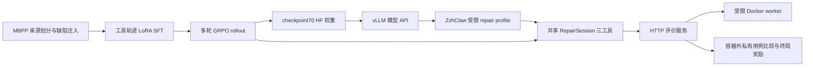
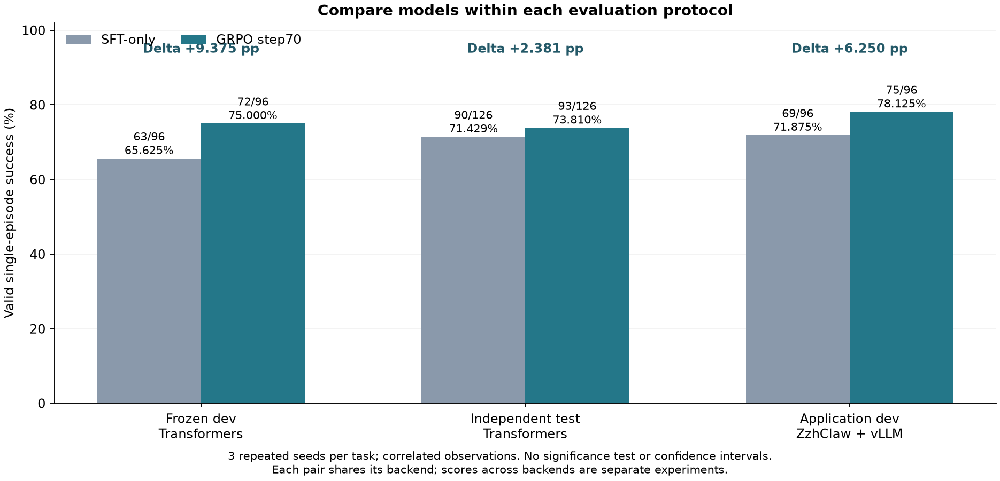

# ZzhClaw 配套代码修复 Agent 后训练

基于 Agent-R1 / verl 和 Qwen2.5-Coder-1.5B-Instruct，完成受限 Python 单文件修复环境、LoRA SFT、全参数 GRPO、独立测试，以及 ZzhClaw CLI 回接。目标是让模型在真实工具反馈和执行验收下完成修复，而不是只生成一段看起来正确的答案。

## 项目结构



模型只允许 `read_file`、`write_file`、`run_tests`，在临时工作区修复 `solution.py`，不能访问私有用例或参考实现。公开测试反馈进入后续 prompt；私有验收只在终局返回汇总奖励。终局奖励为 0/1，每条轨迹只计一次，基础设施错误从正常模型失败中单列。

## 已完成的工程与训练

- 构建 300 train / 32 dev 修复任务，按原题来源隔离；最终 test 从 50 个预先冻结来源中按模型无关规则保留 42 个、排除 8 个。
- 独立 Docker 验收服务：固定镜像 digest、禁网、非 root、只读根文件系统、资源上限与超时。模型端只持有公开资源，私有期望值在服务端比较。
- 315 个 train-only 监督样本、80 次 LoRA SFT 更新；排除诊断来源，检查 response-only 标签与权重变化。
- 接入实际 Agent-R1 多轮 Flow，对生成 token mask、trajectory 分组、终局奖励和组内优势做真实优化 batch 审计；训练完成更新至 74，采用最近完整 checkpoint70。
- 实现 checkpoint 完成标记与安全轮换，采用不保存优化器动量的轻量状态方案，明确重启与不中断训练不等价。
- 增加 ZzhClaw 受限 CLI profile，复用训练时的工具、解析器、环境与预算，通过 vLLM 服务完成 192 条应用 dev episode 的配对对照。

## 效果证据

| 范围 | SFT-only | SFT + GRPO step70 | 差值 |
| --- | ---: | ---: | ---: |
| 冻结 dev，Transformers | 63/96（65.625%） | 72/96（75%） | +9.375 pp |
| 独立 test，Transformers | 90/126（71.429%） | 93/126（73.810%） | +2.381 pp |
| ZzhClaw 应用 dev，vLLM | 69/96（71.875%） | 75/96（78.125%） | +6.25 pp |

每行仅比较同环境模型。三次 seeds 是重复单次 episode，不是 pass@3；同源变体与 seeds 相关，未做统计显著性检验。最终 test 配对改善 7、退化 4；应用 dev 改善 9、退化 3。独立 test 的提升较小，应与明显的 SFT 初始可用性收益分开陈述。



## 展示与复现入口

```bash
python3 scripts/day15_demo.py --case improvement
python3 scripts/day15_demo.py --case regression
python3 scripts/day15_demo.py --case shared-failure
```

这些命令回放已记录的 dev 工具轨迹，不访问网络、不调用模型、不执行候选代码。真实模型演示与报告重算见 [复现指南](DAY15_REPRODUCE.md)；简历与追问准备见 [简历与面试材料](RESUME_AND_INTERVIEW.md)。

## 结论范围

当前是 MBPP 来源的单文件、三个工具、最多六次决策的原型；未做任意真实仓库或完整通用 UI 验收。GRPO 连续五个 batch 无相对奖励信号触发保护停止，原 225 步计划未完成，不能声称收敛或完成 225/255 步。step70 后的 71–74 步未保存；重新训练会重建 Adam 动量。

本机保存完整评估轨迹及报告，完整模型权重的实例外备份尚未验收。完整 SFT 80 步曲线可复算；GRPO 本机只保留 1–11 和 63–74 步的 batch 指标切片，12–62 不插值，不能将其包装成连续完整的学习曲线。
